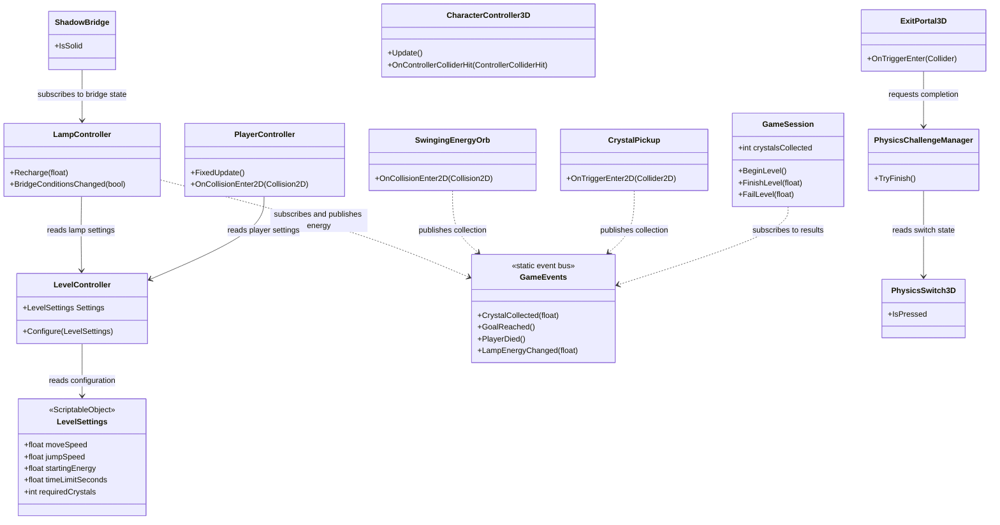
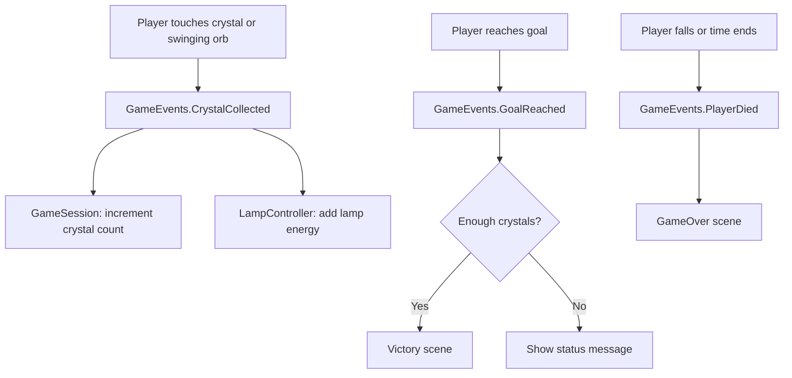
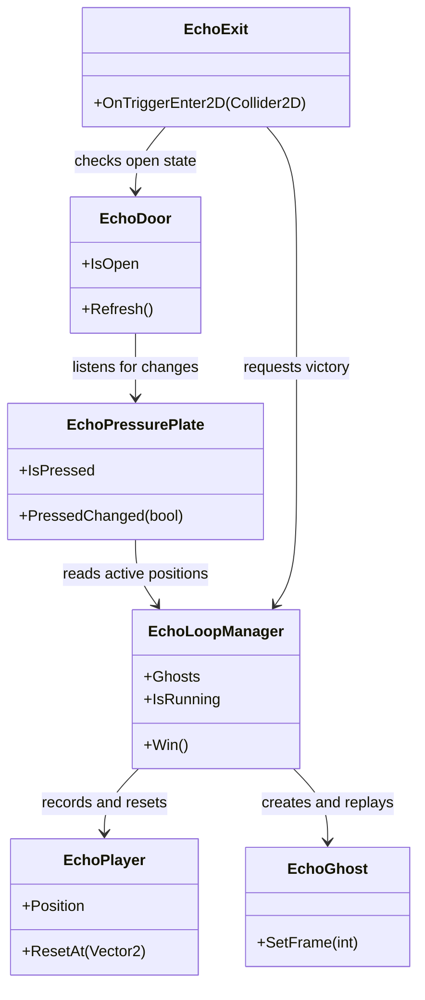

# Homework 4 — Shadow Switch + Echo Shift

**Unity 6.3.25f1 | Two original 2D game concepts + a 3D physics demonstration | C#**

## Overview

Shadow Switch is a physics-based platform puzzle. The player must collect a crystal, operate a lamp, correctly aim its beam toward a designated obelisk, create a temporary solid shadow bridge, and cross the gap before the timer expires. Falling into the pit or running out of time causes a game over.

The **Physics Bonus (3D)** is a separate, small physics challenge that demonstrates Unity's 3D `CharacterController`: move around the arena, push a Rigidbody crate onto a pressure switch, then reach the exit portal.

The project contains **two distinct original game loops**: Shadow Switch and Echo Shift. The **Physics Bonus (3D)** is a demonstration of Unity physics features, not a third original game concept.

**Echo Shift** is a time-loop platform puzzle: every ten seconds, a replay of the player's actions becomes an echo. Coordinate up to three echoes to hold two pressure plates and open the exit.

## How to run

1. Open the Unity project folder in **Unity 6000.3.25f1** (or a compatible Unity 6 editor).
2. Open `Assets/Scenes/MainMenu.unity`.
3. Press **Play** in the **Game** window (not Device Simulator for keyboard testing).
4. Choose **SHADOW SWITCH**, **PHYSICS BONUS (3D)**, or **ECHO SHIFT**.

**Shadow Switch controls:** A/D or arrow keys = move; Space = jump; E = lamp on/off; J/L or mouse = aim; R = restart; Escape = main menu.

**Physics Bonus 3D controls:** W/A/S/D = move; Space = jump; E = push the crate by raycast; R = restart; Escape = main menu.

**Echo Shift controls:** A/D or arrows = move; Space/W = jump; R = restart; Escape = main menu.

The finished project contains six scenes: `MainMenu`, `Level02`, `Victory`, `GameOver`, `PhysicsBonus3D`, and `EchoShift`. All six scenes have been committed to GitHub (verified 21 November 2026).

## Core game loop and win/loss conditions

1. In `Level02`, `LevelController` starts a new attempt through `GameSession.BeginLevel()`.
2. The player moves with `Rigidbody2D`. Jumping uses an impulse and ground checks use 2D raycasts.
3. Touching `CrystalPickup` raises `GameEvents.CrystalCollected(energyReward)`. Both `GameSession` (crystal count) and `LampController` (recharge) react to the same event.
4. The player lights and aims the lamp. `LampController` notifies `ShadowBridge` when its conditions change. The bridge collider is enabled only when the beam is correctly aligned and the lamp has energy.
5. Touching the exit raises `GameEvents.GoalReached`. `GameSession` checks the required crystal count and loads `Victory` only if the requirement is met.
6. Falling into the pit or reaching the time limit raises `GameEvents.PlayerDied`, leading to `GameOver`.

The 3D bonus is independent: a physical crate activates `PhysicsSwitch3D`; `PhysicsChallengeManager` allows completion when the player enters `ExitPortal3D` **while the plate is active**.

## Code organization

```text
Assets/
  Art/
  Data/
    LevelSettings.asset
  Editor/
    Homework3ProjectBuilder.cs
    Homework3BuildExporter.cs
    Homework4ProjectSetup.cs
    Homework4BuildExporter.cs
    Homework4EchoShiftBuilder.cs
    Homework4AllGamesBuildExporter.cs
  Prefabs/
  Scenes/
    MainMenu.unity
    Level02.unity
    Victory.unity
    GameOver.unity
    PhysicsBonus3D.unity
    EchoShift.unity
  EchoShift/Art/
  Scripts/
    EchoShift/     EchoFrame.cs, EchoPlayer.cs, EchoGhost.cs,
                   EchoPressurePlate.cs, EchoDoor.cs, EchoExit.cs, EchoLoopManager.cs
    Player/        PlayerController.cs, MobileInputState.cs, CharacterController3D.cs
    Game/          GameSession.cs, LevelController.cs, GoalTrigger.cs,
                   PitTrigger.cs, PhysicsChallengeManager.cs
    World/         LampController.cs, ShadowBridge.cs, MoteSpawner.cs,
                   MoteLife.cs, PrefabSpawner.cs, SwingingEnergyOrb.cs,
                   PhysicsSwitch3D.cs, ExitPortal3D.cs
    Collectibles/  CrystalPickup.cs
    UI/            GameMenuUI.cs, TouchControlButton.cs
    Events/        GameEvents.cs
    Data/          LevelSettings.cs
```

## Class relationships (UML)



### Event-driven communication



## Architecture decisions and tradeoffs

1. **Event bus instead of tightly coupled pickups:** `CrystalPickup` previously called both `GameSession` and `LampController` directly. It now raises one `GameEvents.CrystalCollected` event; the session and lamp react independently. This makes a new collectible easier to introduce without rewriting the receiver classes. The cost is that event subscriptions need lifecycle discipline; listeners register and unregister in `OnEnable`/`OnDisable`.
2. **Configuration separated from behavior:** `LevelSettings` is a `ScriptableObject` asset (`Assets/Data/LevelSettings.asset`) containing player speeds, lamp energy/drain, timer, required crystals and reward values. Tweaking a level does not require editing hard-coded numeric values in C#.
3. **Different physics models have different responsibilities:** The 2D game uses `Rigidbody2D`, `Physics2D` and `DistanceJoint2D`; the isolated 3D challenge uses `CharacterController`, `Rigidbody` and `Physics.Raycast`. Splitting these systems keeps the original game playable instead of mixing incompatible 2D/3D physics APIs in one player script.

**Static and singleton choices:** `GameEvents` is a static event bus shared by the scene components. `GameSession.Instance` is a persistent singleton (`DontDestroyOnLoad`) because results must survive scene transitions. `LampController.Instance` is used for the active level's lamp by a few legacy consumers. `MobileInputState` is static transient input shared between touch UI and gameplay, reset on level start. Other gameplay communication is preferably through local references and events.

**Clean-code responsibilities:** `PlayerController` handles player movement and grounded state; `CrystalPickup` detects pickup; `LampController` handles lamp state/aim/energy; `ShadowBridge` handles bridge collider/visual state; `GameSession` handles win/loss and result recording; `LevelController` handles the timer and level UI. The 3D puzzle has separate `CharacterController3D`, `PhysicsSwitch3D` and `PhysicsChallengeManager` classes.

## Adding a new collectible: what changes?

For another energy pickup, duplicate the existing Crystal prefab, adjust its sprite and `energyReward`, and keep the `GameEvents.RaiseCrystalCollected(reward)` mechanism. No change is needed in `GameSession` or `LampController`. For a level-wide change to normal crystal rewards, edit `crystalEnergyReward` in the `LevelSettings` asset. If a fundamentally different reward is needed (not energy and crystal count), introduce a new event and listeners instead of overloading `CrystalCollected`.

## Physics requirements — where to find them

| Requirement | Implementation | Evidence |
| --- | --- | --- |
| `CharacterController` | 3D bonus player | `CharacterController3D.cs` with `CharacterController.Move()` |
| `Rigidbody` / `Rigidbody2D` | 2D player, swinging orb, 3D crate | `PlayerController.cs`; `SwingingEnergyOrb.cs`; `PhysicsBonus3D.unity` |
| `AddForce` / `AddTorque` | 2D player/orb impulse and 3D crate push | `PlayerController.FixedUpdate()`; `SwingingEnergyOrb.Start()`; `CharacterController3D.Push()` |
| `Raycast` / `SphereCast` | 2D ground checks and 3D forward interaction | `PlayerController.IsGrounded()`; `CharacterController3D.Update()` |
| `Collision2D` / `Collision` | Landing and orb-player collisions | `PlayerController.OnCollisionEnter2D()`; `SwingingEnergyOrb.OnCollisionEnter2D()` |
| `Joint` / `Effector` | Hanging energy orb | `DistanceJoint2D` added by `Homework4ProjectSetup` |

## Manual test record (21 Nov 2026)

The following were confirmed during manual Unity Editor testing, as reported by the developer:

- Shadow Switch gameplay: working.
- Physics Bonus 3D player movement and jump in the **Game** tab: working.
- Crate pushing with E: working.
- Green pressure switch: working.
- Purple exit portal: working.
- Echo Shift: opens, ten-second echo replay works, two switches open the gate, and the win screen appears.
- Unity Console: no red errors observed during those checks.

Verified from the student's Unity tests: Echo Shift loss after eight unfinished loops, max-three-echo replacement, R restart and Escape navigation. The six-scene WebGL build succeeded, and the student reported successful browser play on itch.io. Still verify separately: Shadow Switch time-limit loss, pit loss, victory requiring a crystal, lamp energy exhaustion and swinging orb collection.

## Export and publish

1. If needed, run `Homework 4 > Upgrade Existing Project` in the Editor to generate the settings asset and bonus scene. Avoid running the Homework 3 scene generator afterward: it can overwrite upgraded scenes.
2. Run **`Homework 4 > Export WebGL (6 scenes incl. Echo Shift)`** and confirm the build succeeds in the Console.
3. Zip the **contents of** `Builds/WebGL_Homework4_AllGames`, not the parent folder. The ZIP root must contain `index.html` and the rest of the generated build files.
4. Upload the ZIP on itch.io as an HTML/browser game, then test **all three menu options** in an ordinary browser.
5. Commit the full Unity source project to GitHub (`Assets`, `Packages`, `ProjectSettings`, and this README). Do not commit generated `Library`, `Temp`, `Obj` or `Builds` directories.

**itch.io playable version:** https://projectgame12.itch.io/homework-4-shadow-switch-echo-shift

## Repository preparation

Place this file at the repository root as `README.md` so GitHub renders the Mermaid diagrams automatically. If a root README already exists, merge any required course/repository links instead of losing them. Use a Unity-appropriate `.gitignore`.


---

## Echo Shift – second original game core loop

**Original idea:** A 2D puzzle-platformer where the player cooperates with recordings of their own previous ten-second movements. Unlike the 3D Physics Bonus, Echo Shift is a separate game concept with an independent win/lose loop.

**Gameplay:** Move left/right, jump, and stand on a pressure plate. At the end of each 10-second cycle, the player resets to the start and a transparent ghost replays the recorded motion. Up to three ghosts can coexist; new recordings replace the oldest after the capacity is reached. To win, use successive recordings to keep switches A and B held simultaneously, opening the gate so the active player can reach the exit. Running out of allotted cycles or falling from the map causes a loss, with a retry option.

**Controls:** A/D or arrows = move, Space/W = jump, R = restart, ESC = main menu.

**Architecture:** `EchoPlayer` owns Rigidbody2D motion; `EchoLoopManager` records/plays fixed-step snapshots and handles win/loss; `EchoGhost` only replays a visual position; `EchoPressurePlate` detects occupancy by active player or ghosts and raises `PressedChanged`; `EchoDoor` subscribes to those events; `EchoExit` allows only the active player to finish.



**Design decision:** Replays are visual and do not physically block the player; pressure plates deliberately interpret ghost positions as occupancy. This avoids unstable feedback from replaying dynamic Rigidbody2D forces and preserves repeatability across loops. Movement snapshots are sampled at Unity's fixed physics interval, so the same echo path repeats independently of rendered frame rate. The manager and components are deliberately smaller scripts with single responsibilities.

**Small change example:** To add a third pressure plate, add another `EchoPressurePlate` object, assign it to an expanded `EchoDoor` or a dedicated door-requirements component, and leave the recording/ghost system unchanged. Configurable values such as `loopSeconds`, `maxEchoes` and `maxLoops` are exposed in the Inspector on `EchoLoopManager`.

**Manual verification:** Student testing in the Unity Game tab confirmed Echo Shift opens, echoes replay every ten seconds, two pressure plates unlock the door, the active player wins, three-echo replacement works, eight-loop loss works, R restart works, Escape returns to menu, and the Console has no red errors. The six-scene WebGL build succeeded; the student also reported that the published itch.io game runs correctly in the browser.


## Submission checklist

- [x] `Assets/Scenes/EchoShift.unity` and its `.meta` are in the GitHub repository
- [x] All seven `Assets/Scripts/EchoShift/*.cs` scripts and both new editor scripts are committed
- [x] `README.md` documents both original game concepts and UML diagrams
- [x] Echo Shift: max three ghosts, eight-loop loss, restart and navigation checked (student-reported)
- [ ] Shadow Switch: loss/win edge cases and swinging orb checked
- [x] Six-scene WebGL build succeeded (Unity Console, student screenshot)
- [x] The student reported that all three menu choices launch on itch.io; link included below
- [ ] Required peer review / Pull Request addressed or course exception confirmed

**GitHub:** https://github.com/pojectgame12/HomeWork4  
**itch.io:** https://projectgame12.itch.io/homework-4-shadow-switch-echo-shift
