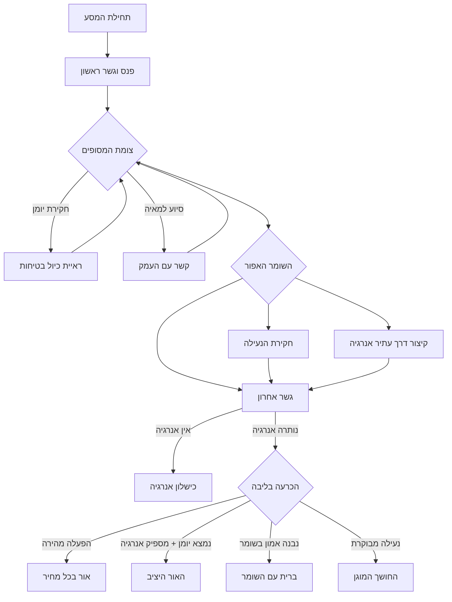

# Shadow Switch – מפת עלילת Twine

העץ מתאר **מבנה סיפורי**, לא קוד משחק Unity. למסוף היומן ולקשר עם מאיה ניתן לחזור, אך הסיפור חוסם בחירה חוזרת באותה פעולה; הן צורכות אנרגיה רק פעם אחת.

**דוגמה להשפעה ממשית של בחירות:** מסלול הכולל חקירת יומן, עזרה למאיה והימנעות מבזבוז אנרגיה מאפשר להפעיל את הליבה בבטחה ולקבל סיום מלא. מסלול שמבזבז אנרגיה על הגברת הפנס אחרי שתי הפעולות עלול להסתיים ללא אנרגיה לפני חדר הליבה.
